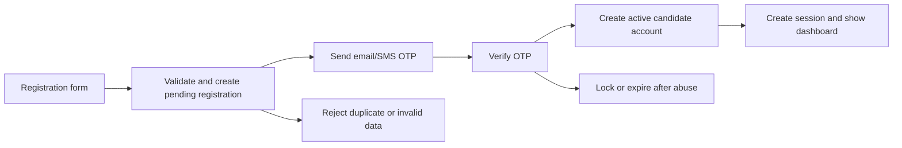

# Candidate Registration and Identity Verification Architecture

## 1. Objective

Extend the current `nextjs-dashboard` Next.js application with a secure, accessible candidate registration flow for G.C.E. examination services.

The registration process must collect the candidate’s examination identity, create a protected account, verify ownership of the contact channel, and record consent. It must be safe for minors, resilient to duplicate registrations and OTP abuse, and easy to complete on a mobile phone.

This architecture uses the current application as the template:

- Next.js App Router pages and route handlers.
- TypeScript and Tailwind CSS.
- `zod` validation at the server boundary.
- Postgres/Neon through the existing `postgres` client.
- Server-only password hashing and session cookies.
- Existing `/login`, `/signup`, `/dashboard`, and `app/lib` conventions.

## 2. Current state and required change

The current `/signup` page accepts only name, email, and password. The current `signup` server action creates a citizen user immediately after password validation. It does not yet collect examination identity, verify an OTP, or store consent.

The target flow changes account creation to:



No account should become active, and no session should be issued, until identity verification succeeds.

## 3. Registration fields

| Field | Required | Storage and validation |
|---|---:|---|
| **Full name** — exactly as registered for the examination | Yes | Trimmed, Unicode-aware, 2–150 characters; preserve display form and store a normalized comparison form |
| **Date of birth** | Yes | Valid calendar date; not future; enforce configured minimum/maximum age policy without assuming all candidates are adults |
| **Candidate/Registration number** | Yes | Exact exam-system format from configuration; uppercase/trim for lookup; unique per examination session |
| **Series** | Yes | Select **ARTS** or **SCIENCE**; store the selected examination series |
| **Sex** | Yes | Select **MALE** or **FEMALE**; store on the candidate profile |
| **Certificate number** | Yes | Select from the approved certificate numbers listed on the registration form |
| **School** | Yes | Select from the four listed government schools on the registration form |
| **G.C.E. examination session/year** | Yes | Controlled selection, not free text; only open/allowed sessions can register |
| **Examination centre/school** | Yes | Select from an approved centre list where possible; store immutable centre ID and display snapshot |
| **Email address or phone number** | Yes, at least one | Normalize email to lowercase or phone to E.164; verify the selected channel with OTP |
| **Username** (if required) | Conditional | Unique, 3–30 characters, lowercase comparison, letters/numbers/period/underscore/hyphen only; do not require it when email login is sufficient |
| **Strong password** | Yes | 12+ characters recommended, max 128; reject common/breached passwords; do not require arbitrary symbol rules that harm usability |
| **Confirm password** | Yes | Must match password in the same request; never store it |
| **Identity verification** — e.g., OTP sent to email/phone | Yes | One-time, short-lived, single-use challenge bound to the pending registration and channel |
| **Terms & privacy agreement** | Yes | Explicit unchecked consent; store policy versions, timestamp, and consent purpose |

### Full-name policy

The form must explain that the name should match the examination registration exactly. Do not silently change accents, hyphens, apostrophes, or name order. Store:

- `full_name`: the trimmed user-entered display value.
- `full_name_normalized`: a comparison value used only for matching/search.

The normalized value must not replace the official display value on certificates or examination records.

## 4. Recommended routes

### Pages

```text
/signup                         Start registration
/signup/verify                  Enter OTP and resend code
/signup/success                 Confirm account activation
/login                          Existing login
/account/recovery               Start password recovery
/account/recovery/verify        Verify recovery OTP
/dashboard                      Authenticated candidate home
/dashboard/profile              View/edit permitted profile fields
/dashboard/examination          Candidate examination identity and status
```

### API route handlers

```text
POST /api/auth/register/start       Validate form, create pending registration, send OTP
POST /api/auth/register/verify      Verify OTP and activate candidate account
POST /api/auth/register/resend      Issue a replacement OTP within limits
POST /api/auth/recovery/start       Start password recovery
POST /api/auth/recovery/verify      Verify recovery OTP and rotate password
GET  /api/examinations/sessions     Return allowed session/year choices
GET  /api/examination-centres       Return approved centre/school choices
GET  /api/health                    Health/readiness check
```

Route handlers should only perform request parsing, rate limiting, authorization, service invocation, and response formatting. SQL, OTP generation, password policy, and duplicate rules belong in services and repositories.

## 5. Data model

The current `users` table can remain the authentication principal, but candidate identity should be modeled separately from credentials.

```text
users
  id UUID primary key
  email TEXT nullable unique after normalization
  phone_e164 TEXT nullable unique
  username TEXT nullable unique after normalization
  password_hash TEXT NOT NULL
  role TEXT NOT NULL DEFAULT 'candidate'
  status TEXT NOT NULL DEFAULT 'pending' | 'active' | 'locked' | 'disabled'
  email_verified_at TIMESTAMPTZ nullable
  phone_verified_at TIMESTAMPTZ nullable
  created_at, updated_at

candidate_profiles
  user_id UUID primary key references users
  full_name TEXT NOT NULL
  full_name_normalized TEXT NOT NULL
  date_of_birth DATE NOT NULL
  candidate_number TEXT NOT NULL
  candidate_number_normalized TEXT NOT NULL
  series TEXT NOT NULL CHECK (series IN ('Arts', 'Science'))
  sex TEXT NOT NULL CHECK (sex IN ('MALE', 'FEMALE'))
  examination_session_id UUID NOT NULL references examination_sessions
  examination_centre_id UUID NOT NULL references examination_centres
  created_at, updated_at

examination_sessions
  id UUID primary key
  name TEXT NOT NULL
  year INT NOT NULL
  status TEXT NOT NULL CHECK (status IN ('open', 'closed', 'archived'))
  registration_opens_at, registration_closes_at

examination_centres
  id UUID primary key
  code TEXT NOT NULL unique
  name TEXT NOT NULL
  status TEXT NOT NULL CHECK (status IN ('active', 'inactive'))

pending_registrations
  id UUID primary key
  registration_key TEXT NOT NULL unique
  email TEXT nullable
  phone_e164 TEXT nullable
  username TEXT nullable
  password_hash TEXT NOT NULL
  registration_payload JSONB NOT NULL
  expires_at TIMESTAMPTZ NOT NULL
  attempts INT NOT NULL DEFAULT 0
  status TEXT NOT NULL CHECK (status IN ('pending', 'completed', 'expired', 'cancelled', 'locked'))
  created_at, completed_at

otp_challenges
  id UUID primary key
  registration_id UUID references pending_registrations
  purpose TEXT NOT NULL CHECK (purpose IN ('registration', 'recovery', 'contact_change'))
  channel TEXT NOT NULL CHECK (channel IN ('email', 'sms'))
  destination_hash TEXT NOT NULL
  code_hash TEXT NOT NULL
  expires_at TIMESTAMPTZ NOT NULL
  attempts INT NOT NULL DEFAULT 0
  consumed_at TIMESTAMPTZ nullable
  created_at TIMESTAMPTZ NOT NULL DEFAULT now()

consents
  id UUID primary key
  user_id UUID references users
  registration_id UUID references pending_registrations
  consent_type TEXT NOT NULL CHECK (consent_type IN ('terms', 'privacy', 'communications'))
  policy_version TEXT NOT NULL
  accepted_at TIMESTAMPTZ NOT NULL
  ip_hash TEXT
  user_agent_hash TEXT

identity_events
  id UUID primary key
  user_id UUID nullable
  registration_id UUID nullable
  event_type TEXT NOT NULL
  result TEXT NOT NULL
  reason TEXT nullable
  request_id TEXT NOT NULL
  created_at TIMESTAMPTZ NOT NULL DEFAULT now()
```

### Important constraints

- A candidate number is unique within an examination session, not necessarily globally.
- At least one contact channel must be present.
- Email and phone may be nullable individually but not both.
- A username, when required, is unique case-insensitively.
- Candidate account creation and consent records commit in one transaction after OTP verification.
- OTP codes are never stored in plaintext.
- Pending registration payloads expire and are deleted or anonymized by a scheduled cleanup job.
- Do not store a full date of birth in verification logs.

## 6. Registration workflow

### Step 1 — Form entry

Use a progressive, mobile-first form rather than one overwhelming screen:

1. Examination identity: full name, date of birth, candidate number, session/year, centre/school.
2. Contact and login: email/phone, optional username, password, confirmation.
3. Review: a read-only summary and terms/privacy checkboxes.
4. Verification: OTP entry and resend control.

Client-side validation improves feedback but is never trusted. Preserve valid form values after a validation error without preserving the password in the URL, logs, or server-rendered error query parameters.

### Step 2 — Start registration

`POST /api/auth/register/start`:

1. Validate content type and request size.
2. Normalize lookup values.
3. Validate session is open and centre is active.
4. Validate candidate number format and date rules.
5. Check duplicate candidate identity, email, phone, and username.
6. Hash the password with a slow password-hashing function.
7. Create a short-lived pending registration.
8. Generate a cryptographically random OTP, store only its hash, and send it through the selected channel.
9. Return a non-sensitive registration reference and redirect the browser to `/signup/verify`.

Public duplicate responses should be generic where account enumeration is a concern. Internal logs can retain the exact conflict reason.

### Step 3 — Verify OTP

`POST /api/auth/register/verify`:

1. Check registration reference, challenge purpose, expiry, and attempt count.
2. Compare the submitted OTP against the stored hash.
3. Mark the challenge consumed atomically; a code can never be reused.
4. Create the active user, candidate profile, consents, and audit event in one transaction.
5. Delete or invalidate pending registration material.
6. Set a rotated secure session cookie.
7. Redirect to the candidate dashboard.

If the OTP fails, increment attempts atomically. Lock the challenge after the configured maximum and require a new challenge.

## 7. OTP and contact verification policy

Defaults should be configuration, not hard-coded:

- Six numeric digits or an equivalent high-entropy code.
- Expiry: 10 minutes.
- Maximum verification attempts per challenge: 5.
- Resend cooldown: 60 seconds.
- Maximum resends per registration: 5 per hour.
- Maximum starts per IP, destination, and device fingerprint: configurable.
- New OTP invalidates the prior OTP.
- Do not reveal whether a destination is already registered.

Email and SMS providers must be behind a small adapter interface so the application can switch providers and test locally with a fake provider.

## 8. Validation and edge cases

### Input edge cases

- Blank, whitespace-only, or excessively long names.
- Unicode names, accents, apostrophes, hyphens, and multiple spaces.
- Future birth date, impossible calendar date, or date outside policy.
- Candidate number with spaces, wrong check digit, wrong session, or leading zeros.
- Closed, archived, or unavailable examination session.
- Inactive or changed examination centre.
- Email casing, plus addressing, invalid domains, and Unicode normalization.
- Phone numbers with local prefixes, spaces, extensions, or unsupported country codes.
- Username casing, reserved names, impersonation names, and Unicode confusables.
- Password equal to name, candidate number, date of birth, or a common breached password.
- Mismatched confirmation password.
- Terms unchecked or outdated policy version.
- Both email and phone absent.
- Both channels supplied but only one verified.

### Flow and infrastructure edge cases

- Double-click on submit: idempotency key prevents duplicate pending registrations.
- Browser refresh after form submit: resume by opaque registration reference only.
- OTP arrives late after resend: old code is rejected.
- User opens two verification tabs: only one atomic consume succeeds.
- Session or registration expires: offer safe restart, not a server error.
- Email/SMS provider timeout: do not activate; allow controlled retry.
- Database failure during activation: transaction rolls back; never issue a partial account.
- User loses access to the contact channel: route to support/manual identity recovery.
- Rate limit reached: show retry time without exposing account existence.
- Network failure: preserve local non-sensitive form progress and clearly distinguish retry from invalid data.
- Age/minor restrictions: use configurable policy and guardian/support workflow where required; do not infer consent from the candidate’s age alone.
- Candidate already registered for the same session: provide recovery/help guidance, not a second account.

## 9. Security and privacy

- Use Argon2id where available; otherwise use the existing bcrypt implementation with a calibrated cost.
- Never log passwords, OTP codes, full registration payloads, date of birth, or raw contact values.
- Hash contact values in abuse/audit records; encrypt sensitive profile data at rest where required by policy.
- Use secure, HTTP-only, same-site cookies; rotate the session after activation and login.
- Add CSRF protection to state-changing browser requests.
- Rate-limit registration starts, OTP verification, resends, login, and recovery independently.
- Add bot protection only when risk signals justify it; preserve accessibility.
- Use generic responses for duplicate email/phone/candidate lookups.
- Restrict profile edits: changing candidate number, birth date, session, or centre requires support/admin review and an audit event.
- Define retention periods for pending registrations, OTP challenges, identity logs, and inactive accounts.
- Obtain separate opt-in consent for marketing or non-essential communications; terms and privacy acceptance cannot be preselected.
- Version and link the exact terms/privacy documents accepted by the candidate.

## 10. User-friendly experience

The registration UI should use the existing Tailwind visual language but improve clarity:

- Step indicator: `Examination details → Account details → Verify contact`.
- Plain helper text beside “Full name”: “Enter it exactly as it appears on your examination registration.”
- Date picker plus an accessible text input fallback.
- Searchable centre/school selector with code and name.
- Session/year dropdown populated from the server, not free text.
- Password strength meter with actionable guidance and show/hide control.
- Confirmation summary before the OTP is sent.
- OTP inputs that support paste, keyboard navigation, screen readers, and automatic focus.
- Resend countdown with a clear “use a different contact” option.
- `aria-live` status messages, visible focus, 44px touch targets, and no color-only errors.
- Never display a password or OTP in browser history, query strings, analytics, or support screenshots.

Success should clearly show:

- Account activated.
- Verified contact channel.
- Candidate number and examination session.
- Next action: open dashboard, review details, or contact support.

## 11. Authorization and candidate dashboard

Candidate users may view their own profile and examination registration. They must not query another candidate by changing a URL ID.

Admin users may manage sessions, centres, duplicate-resolution cases, and support verification, but sensitive fields should be masked by default and every access should be audited.

Certificate issuance remains an admin capability. Candidate certificate views should link into the existing certificate verification model without exposing private registration data publicly.

## 12. Observability

Record structured events using a request ID:

```json
{
  "event": "candidate.registration",
  "result": "otp_sent",
  "registration_id": "opaque-reference",
  "session_id": "uuid",
  "request_id": "req_123",
  "latency_ms": 210
}
```

Recommended metrics:

- `candidate_registration_started_total`
- `candidate_registration_completed_total`
- `candidate_registration_rejected_total{reason_group}`
- `otp_sent_total{channel}`
- `otp_verified_total{result}`
- `otp_resend_total`
- `registration_provider_failures_total{channel}`
- `registration_latency_ms`

Alert on OTP provider failure, unusually high invalid OTP volume, duplicate candidate spikes, registration abuse by IP/destination, and activation transaction failures.

## 13. Testing plan

### Unit tests

- Name normalization without losing display characters.
- Candidate number/session uniqueness rules.
- Date-of-birth boundaries and invalid dates.
- Email/phone normalization.
- Password policy and confirmation matching.
- OTP hashing, expiry, retry count, and single-use behavior.
- Consent version validation.

### Integration tests

- Successful registration through OTP activation.
- Duplicate candidate, email, phone, and username cases.
- Closed session and inactive centre.
- Resend invalidating the previous OTP.
- Two concurrent OTP verification requests.
- Provider timeout and database rollback.
- Session creation only after successful verification.
- Candidate cannot access another candidate’s profile.

### Browser tests

- Mobile completion of every form step.
- Keyboard and screen-reader OTP interaction.
- Password visibility and strength feedback.
- Refresh/recovery from an in-progress registration.
- Camera-independent flow: registration must not require QR or camera access.
- Error recovery without losing non-sensitive entered values.

## 14. Implementation roadmap

### Phase 1 — domain and schema

- Add examination sessions and centres.
- Add `candidate_profiles`, pending registrations, OTP challenges, consents, and identity events.
- Add normalized/unique indexes and cleanup policy.
- Add schemas and service/repository boundaries under `app/lib/domain/registration`.

### Phase 2 — registration UI and APIs

- Replace the current minimal `/signup` form with the three-step flow.
- Add registration start, OTP verify, resend, and recovery handlers.
- Add email/SMS adapter with a development fake provider.
- Add request IDs and rate limiting using the existing security utilities.

### Phase 3 — operations and support

- Add admin session/centre management.
- Add duplicate-resolution and manual verification workflow.
- Add metrics, alerts, retention jobs, and support audit views.

### Phase 4 — production hardening

- Add MFA for administrators.
- Add bot/risk controls, provider failover, backups, and disaster recovery.
- Run accessibility, security, load, and privacy reviews.

## 15. Definition of done

- All eleven requested registration requirements are represented in the UI, server schema, and persisted data model.
- The candidate cannot activate an account without successful OTP verification.
- Candidate identity is unique within the selected examination session.
- Passwords and OTPs are never stored or logged in plaintext.
- Terms/privacy versions and timestamps are auditable.
- Duplicate, expiry, concurrency, provider, network, and authorization edge cases are tested.
- The flow works on mobile, keyboard-only navigation, and assistive technology.
- Existing certificate verification and admin dashboard behavior remain compatible.
