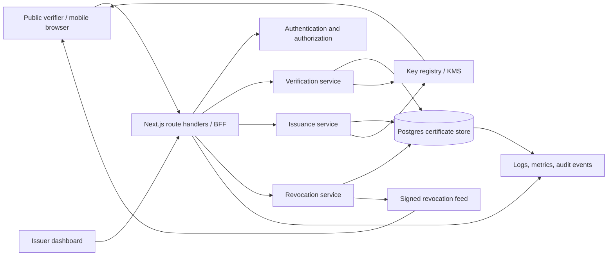
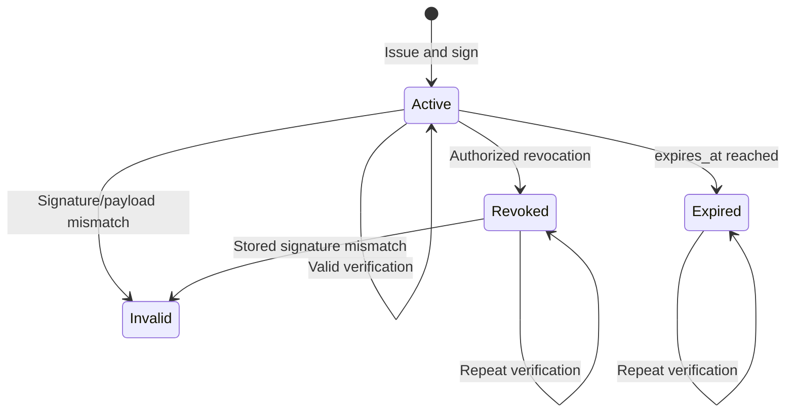

# CertVerify / Next.js Dashboard Architecture

## 1. Purpose

This document describes the architecture of the existing `nextjs-dashboard` application and the target architecture for a production certificate issuance and verification platform.

The product has two trust boundaries:

1. A protected issuer dashboard for administrators who create, search, and revoke certificates.
2. A public verification experience where anyone can enter a certificate identifier or scan a QR code and receive a clear verification result.

The target system must make the verification decision authoritative, auditable, resistant to tampering, and understandable to non-technical users.

## 2. Current repository baseline

### Runtime and framework

- Next.js 16 App Router with React and TypeScript.
- Tailwind CSS for styling.
- Node.js route handlers for server-side cryptographic and database operations.
- Postgres/Neon accessed through the `postgres` package.
- `zod` for request validation.
- Ed25519 signing derived from `CERT_SECRET` in the current implementation.
- `jsqr` for browser QR image/camera decoding.

### Existing routes

| Route | Access | Current responsibility |
|---|---|---|
| `/` | Public | Product landing page |
| `/verify` | Public | Certificate ID/JWS verification and QR scanning |
| `/issuer` | Authenticated UI | Certificate issuance form |
| `/login` | Public | Login form |
| `/signup` | Public | Citizen account creation |
| `/dashboard` | Authenticated | Certificate statistics overview |
| `/dashboard/certificates` | Authenticated | Certificate register and admin actions |
| `/api/certs/issue` | Admin | Issue and persist a signed certificate |
| `/api/certs/verify` | Public | Verify JWS or certificate ID/serial |
| `/api/certs/revoke` | Admin | Revoke an active certificate |
| `/api/certs/revocation-feed` | Public | Return a signed revocation snapshot |
| `/api/.well-known/issuer-keys` | Public | Publish issuer public key metadata |
| `/seed` | Protected setup | Seed demo data |

### Existing code organization

```text
app/
  api/certs/                 HTTP API route handlers
  dashboard/                 Authenticated dashboard pages
  issuer/                    Standalone issuance page
  verify/                    Public verification page
  lib/auth.ts                Cookie session helpers
  lib/actions.ts             Server actions for auth/revocation
  lib/certificates.ts        Signing, parsing, issuance, verification, revocation
  lib/data.ts                Dashboard database queries
  lib/definitions.ts         Shared TypeScript domain types
  lib/postgres.ts            Database client
  ui/                        Reusable UI and dashboard components
scripts/                     Schema initialization and demo seeding
public/                      Static images and customer assets
```

### Current strengths

- The signing private material is server-only; the browser receives only public certificate data or a signed token.
- Certificate verification checks the signature, database existence, stored signature equality, revocation state, and expiry.
- Identifier lookup supports both UUID and human-readable serial values.
- The public page handles QR image upload, camera scanning, QR links, loading states, and the four requested statuses.
- Database writes use parameterized `postgres` tagged queries.
- Admin-only issuance and revocation are enforced in the API and dashboard layer.

### Current gaps to address before production

- `CERT_SECRET` is currently transformed into an Ed25519 private key locally. Production should use a KMS/HSM signing key and support key rotation.
- Sessions are custom HMAC cookies. They need session rotation, revocation, CSRF strategy, rate limiting, and stronger operational visibility.
- There is no durable verification event model separate from the existing audit log.
- Verification and revocation-feed endpoints need rate limiting, request IDs, structured logging, and metrics.
- The revocation feed is signed but has no dedicated feed version, ETag strategy, or independently verifiable key-rotation metadata.
- Certificate payloads contain presentation fields in the signed token. A future version should minimize personal data in QR codes and allow privacy-preserving verification.
- The current database schema does not enforce all certificate/status invariants with constraints.
- There is no automated test suite covering cryptographic, expiry, revocation, authorization, and QR-link edge cases.

## 3. Target architecture



The Next.js application remains the user-facing web application and backend-for-frontend. Domain logic should move behind explicit services so route handlers only authenticate, validate, call a service, and format a response.

## 4. Recommended application structure

```text
app/
  (public)/
    page.tsx
    verify/page.tsx
  (auth)/login/page.tsx
  (auth)/signup/page.tsx
  (dashboard)/dashboard/layout.tsx
  (dashboard)/dashboard/page.tsx
  (dashboard)/dashboard/certificates/page.tsx
  api/
    certs/issue/route.ts
    certs/verify/route.ts
    certs/revoke/route.ts
    certs/[id]/route.ts
    certs/[id]/events/route.ts
    revocations/feed/route.ts
    .well-known/issuer-keys/route.ts
    health/route.ts
  lib/
    domain/certificates/
      certificate.schemas.ts
      certificate.types.ts
      certificate.service.ts
      certificate.repository.ts
      certificate.policy.ts
    domain/verification/
      verification.service.ts
      verification.types.ts
    domain/revocations/
      revocation.service.ts
      revocation.repository.ts
    security/
      auth.ts
      authorization.ts
      rate-limit.ts
      request-id.ts
    crypto/
      signer.ts
      verifier.ts
      key-registry.ts
    db/
      client.ts
      migrations/
    observability/
      logger.ts
      metrics.ts
  ui/
    verification/
    certificates/
    dashboard/
    primitives/
```

### Responsibility rules

- Route handlers must not contain SQL, cryptographic implementation, or business rules.
- Repositories own SQL and return domain-shaped records.
- Services own workflows and transaction boundaries.
- Schemas validate all external input; TypeScript types do not replace runtime validation.
- UI components must not decide whether a certificate is valid; they render the API decision.
- Public responses must avoid leaking internal database errors, signing details, or unnecessary personal data.

## 5. Certificate lifecycle



`Invalid` is a verification result, not a persisted certificate status. It means the supplied token cannot be trusted, is unknown, is malformed, or does not match the stored certificate.

Canonical public statuses:

| Status | Meaning | Certificate details |
|---|---|---|
| `valid` | Signature is authentic, record exists, active, and not expired | Return minimal approved details |
| `expired` | Signature is authentic and record exists, but expiry has passed | Return details and expiry |
| `revoked` | Signature is authentic and record exists, but issuer revoked it | Return safe details and revocation timestamp/reason according to policy |
| `invalid` | Malformed, bad signature, unknown, or payload mismatch | Do not reveal whether an ID exists |

## 6. QR and signed payload design

### Recommended QR value

Use a short HTTPS verification URL when possible:

```text
https://verify.example.com/verify?jws=<compact-token>
```

The page must also accept a raw compact JWS for interoperability. A QR value may contain a future `id` parameter, but ID-only verification must still perform a server-side lookup and signature verification.

### Versioned payload

```json
{
  "v": "1",
  "id": "certificate-uuid",
  "serial": "CERT-8F2A19",
  "iat": 1735689600,
  "exp": 1767225600,
  "kid": "issuer-key-v1",
  "claims": {
    "type": "Completion certificate",
    "recipient_name": "Alex Rivera"
  }
}
```

Rules:

- Use compact JWS or COSE serialization.
- Sign a canonical representation; do not sign an object whose field order can vary.
- Reject unknown versions, unsupported algorithms, unexpected key IDs, oversized tokens, duplicate claims, invalid timestamps, and invalid UUIDs.
- Keep QR payloads small and avoid email, address, or other unnecessary personal data.
- Store the exact signed value in the database for payload-to-record equality checks.
- On key rotation, retain old public keys until every certificate signed by them is outside its verification window.

## 7. Verification flow

1. User opens `/verify`, pastes an ID/serial, uploads a QR image, or grants camera access.
2. Client normalizes a QR URL into `jws` or `id`; it never interprets validity locally.
3. Client submits `POST /api/certs/verify`.
4. Route applies request size limits, rate limits, schema validation, and a request ID.
5. Verification service parses the JWS, validates header/version, resolves the correct public key, and verifies the signature.
6. Service finds the certificate by immutable ID or exact serial.
7. Service compares the supplied token to the stored signature and checks revocation and expiry.
8. Service records a verification event without storing unnecessary raw PII or full tokens.
9. API returns one canonical status and a safe display model.
10. UI displays status, explanation, verification timestamp, and permitted certificate details.

Do not return different public error messages for “unknown ID” and “bad signature” if that would enable certificate enumeration. Internally retain the specific reason for audit and metrics.

## 8. API contract

### `POST /api/certs/verify`

Request, exactly one input:

```json
{ "id": "CERT-8F2A19" }
```

or:

```json
{ "jws": "header.payload.signature" }
```

Response:

```json
{
  "status": "valid",
  "verified_at": "2026-08-26T12:00:00.000Z",
  "certificate": {
    "id": "uuid",
    "serial": "CERT-8F2A19",
    "certificate_title": "Completion certificate",
    "recipient_name": "Alex Rivera",
    "issued_at": "2026-01-01T00:00:00.000Z",
    "expires_at": null
  }
}
```

For `invalid`, return `status` and a safe human-readable message. Never expose stack traces, SQL errors, private keys, or raw database records.

### `POST /api/certs/issue`

- Requires an authenticated admin session or a separately protected machine credential.
- Validates recipient, title, issue date, optional expiry, claim lengths, and image limits.
- Creates the certificate and audit event in one transaction.
- Signs only after all canonical fields are normalized.
- Returns `201` with the certificate ID, serial, signed QR value, and verification URL.

### `POST /api/certs/revoke`

- Requires admin authorization.
- Accepts certificate ID and a bounded reason.
- Uses an atomic `active -> revoked` update so repeated requests are safe.
- Records actor, timestamp, reason, request ID, and source metadata.
- Invalidates or versions cached revocation material.

### Public supporting endpoints

- `GET /.well-known/issuer-keys`: active public keys, algorithm, validity window, and key ID.
- `GET /api/certs/revocation-feed`: signed, versioned snapshot with `issued_at`, `expires_at`, and revoked serials.
- `GET /api/health`: liveness/readiness without exposing configuration.

## 9. Database architecture

The existing `certificates`, `users`, and `certificate_audit_log` tables are a sound starting point. The production schema should add constraints, key metadata, verification events, and idempotency support.

### Core tables

```text
users
  id, name, email, password_hash, role, status, created_at, updated_at

issuer_keys
  kid, algorithm, public_key, status, valid_from, valid_to, created_at

certificates
  id, serial, certificate_version, type, claims_json, holder_name,
  holder_email, issued_at, expires_at, signature, signing_kid,
  status, revoked_at, revoked_reason, created_by, created_at, updated_at

certificate_events
  id, certificate_id, event_type, result, reason, actor_id,
  request_id, ip_hash, user_agent_hash, created_at

revocation_snapshots
  version, issued_at, expires_at, payload_hash, signature, created_at

idempotency_keys
  key, operation, actor_id, response_hash, created_at, expires_at
```

### Invariants

- `serial` is unique and case-normalized.
- `status` is constrained to `active` or `revoked`; derived public `expired` is based on `expires_at`.
- `expires_at` must be later than `issued_at` when present.
- `revoked_at` and `revoked_reason` are null for active records and required/allowed for revoked records according to policy.
- `signing_kid` must reference a known issuer key.
- Certificate issuance and its initial audit event commit atomically.
- Revocation is idempotent and cannot silently reactivate a certificate.
- Search columns have indexes; full-text search can be added when the register grows.

## 10. Authentication and authorization

Roles:

- `admin`: issue, view register, revoke, inspect audit events.
- `citizen`: authenticate and view only their permitted account data.
- `service`: optional non-human integration identity with scoped permissions.
- `public`: verify only; no account required.

Required controls:

- Use secure, HTTP-only, same-site cookies with session rotation after login.
- Store only password hashes using a current password hashing algorithm.
- Add login throttling, generic authentication errors, and optional MFA for admins.
- Validate authorization at the route and service layer; do not rely on hidden UI controls.
- Protect state-changing browser requests with CSRF protection or a strict same-site/API-token strategy.
- Keep machine credentials server-side and scoped to one operation.

## 11. Security and abuse prevention

- Enforce HTTPS, HSTS, secure headers, and a restrictive Content Security Policy.
- Add per-IP and per-client rate limits to verification; use stricter limits for failed signatures.
- Cap JSON body size and QR/token length before parsing.
- Use constant-time signature verification provided by the crypto library.
- Never log raw JWS values, private keys, passwords, or unnecessary recipient data.
- Hash or truncate IP/user-agent values in analytics when possible.
- Use prepared queries only; do not build SQL from user input.
- Add CORS policy only if external verifiers are an intentional product surface.
- Protect `/seed` behind a disabled-by-default deployment flag and remove it from production.
- Prevent certificate enumeration with generic public invalid responses and serial entropy.
- Validate uploaded image MIME type, dimensions, and byte size; do not persist untrusted image content without sanitization.

## 12. User experience architecture

The public verifier should be optimized for a one-handed mobile flow and a clear decision in under five seconds.

Required states:

- Empty: explain ID and QR options with examples.
- Checking: disable duplicate submissions and show progress.
- Valid: green success treatment, verified time, recipient/title, issue and expiry dates.
- Expired: amber warning, authentic-but-no-longer-current explanation, expiry date.
- Revoked: orange/red warning, issuer-revoked explanation, revocation date if policy allows.
- Invalid: red treatment, non-technical next steps, no sensitive lookup details.
- Camera denied/unavailable: offer image upload and manual ID entry.
- Offline/network failure: distinguish “could not reach verifier” from “invalid certificate”; never call a network failure invalid.
- Rate limited: explain that the user should wait and retry.

Accessibility requirements:

- Visible keyboard focus and semantic labels.
- `aria-live="polite"` for verification results and errors.
- Color is not the only status signal; pair it with text and an icon.
- Minimum touch targets of 44px.
- Respect reduced-motion preferences.
- Provide a camera close/stop control and never keep the camera active after navigation.

## 13. Observability and audit

Every request receives a request ID. Emit structured events such as:

```json
{
  "event": "certificate.verify",
  "request_id": "req_123",
  "result": "valid",
  "certificate_id": "uuid",
  "signing_kid": "issuer-key-v1",
  "verifier": "online",
  "latency_ms": 42
}
```

Metrics:

- `certificates_issued_total`
- `certificates_revoked_total`
- `certificate_verifications_total{status}`
- `certificate_verification_latency_ms`
- `invalid_signature_total`
- `rate_limited_requests_total{route}`
- `revocation_feed_age_seconds`

Alerts:

- Verification failure spike.
- Revocation spike.
- Database or KMS errors.
- Revocation feed expired or unable to publish.
- Repeated requests for many sequential IDs.
- Unexpected signing-key usage.

## 14. Caching and offline verification

Online verification is the authoritative path for revocation. For high-volume or disconnected verifiers:

1. Publish a signed revocation snapshot with an explicit version and expiry.
2. Cache issuer public keys and snapshots with ETags and bounded TTLs.
3. Verify the snapshot signature before using it.
4. Use a Bloom filter only as a fast “possibly revoked” pre-check; false positives must trigger an online check.
5. Display “offline, last synchronized at …” rather than “valid” when the authoritative service was not contacted.

## 15. Deployment architecture

```text
Browser / QR scanner
        |
CDN / WAF / TLS termination
        |
Next.js deployment (web pages + route handlers)
        |             \
   Postgres/Neon       KMS/HSM
        |
Observability platform / alerting
```

Environment configuration:

- `POSTGRES_URL`: server-only pooled database connection.
- `AUTH_SECRET`: server-only session signing secret.
- `CERT_ADMIN_TOKEN`: temporary/scoped machine credential, never exposed to the browser.
- `SEED_TOKEN`: setup-only secret; disable after initialization.
- KMS key identifiers and cloud credentials: server-only deployment secrets.

Use separate development, staging, and production databases and signing keys. Back up the database, test restore procedures, and never use production signing keys in local development.

## 16. Testing strategy

### Unit tests

- JWS canonicalization and signature verification.
- Header/key/version rejection.
- Invalid base64, malformed JSON, oversized token, and unsupported algorithm cases.
- Expiry before, at, and after the current second.
- Revocation precedence over expiry.
- Serial normalization and identifier lookup.

### Integration tests

- Issue -> verify -> revoke -> verify lifecycle.
- ID lookup and raw JWS lookup produce the same result.
- Unknown identifiers do not reveal record existence.
- Admin/citizen/public authorization boundaries.
- Database rollback when signing or audit persistence fails.
- Revocation feed signature and expiry.

### Browser tests

- Manual ID success and all four status cards.
- QR image with raw JWS.
- QR image with a verification URL.
- Camera permission denied, camera close, and successful scan.
- Network timeout and retry behavior.
- Keyboard navigation and screen-reader result announcement.

## 17. Implementation roadmap

### Phase 1 — stabilize the current app

- Extract certificate, verification, revocation, and crypto services from route handlers.
- Add database migrations and status/timestamp constraints.
- Add structured request logging and verification event persistence.
- Add automated unit and integration tests.
- Add API body limits, rate limits, generic public invalid responses, and readiness checks.

### Phase 2 — production trust infrastructure

- Move signing to KMS/HSM.
- Add issuer key registry and overlapping key rotation.
- Version signed revocation snapshots and add ETag/TTL support.
- Add alerting, dashboards, backups, and restore drills.

### Phase 3 — issuer and verifier experience

- Add certificate detail pages and audit timeline.
- Add pagination, filters, export permissions, and bulk operational workflows.
- Add accessible responsive design system and browser test coverage.
- Add optional offline verification with explicit confidence messaging.

### Phase 4 — integrations

- Add scoped service accounts and webhooks.
- Add documented API versioning.
- Add external verification SDK or embeddable verifier only after abuse controls are in place.

## 18. Definition of done

The architecture is production-ready when:

- Every public verification result is cryptographically and database-backed.
- Revocation and expiry behavior is deterministic and tested at boundary conditions.
- Admin actions are authorized, idempotent, and auditable.
- Keys are managed and rotated outside application source and environment values.
- Public errors do not leak certificate existence or internal failures.
- Verification is rate-limited, observable, and resilient to camera/network failure.
- Database migrations, backups, tests, deployment configuration, and rollback procedures are documented.
